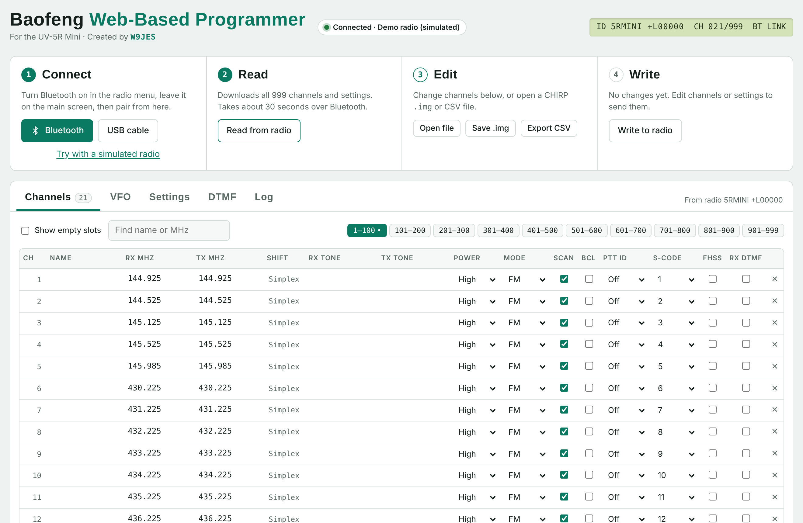

# Baofeng Web-Based Programmer

**Program your Baofeng UV-5R Mini from the browser, over Bluetooth.** Nothing to install, no drivers, no programming cable.

**▶ Open it: [drexjj.github.io/FengRadioProgrammer](https://drexjj.github.io/FengRadioProgrammer/)**

---

## What it does

Pair the radio, read it, edit everything in a CHIRP-style grid, and write it back. The flow works like the Meshtastic web flasher: you click **Bluetooth**, your browser shows a pairing window, and you pick the radio.

- **Wireless programming** over the radio's built-in Bluetooth. A USB programming cable works too.
- **All 999 channels**: name, RX/TX frequency, CTCSS/DCS tones, power, FM/NFM/AM, scan, busy-channel lockout, PTT ID, S-code, frequency hopping and RX DTMF.
- **VFO A and B**: frequency, shift, offset, tones, power, bandwidth and step.
- **35+ radio settings**: squelch, beeps and voice, backlight, dual watch, battery save, timeout, VOX, repeater tone burst, tail elimination and more.
- **DTMF**: ANI code and the 20 PTT ID signal codes.
- **Works with CHIRP.** It opens and saves CHIRP `.img` images and CHIRP CSV channel lists, so you can move between the two freely.
- **Backup on every read.** The radio's original image is kept in your browser, and you can save it as a file before you write anything.
- **Quick entry.** In the TX column type an absolute frequency, a shift like `+0.6` or `-5`, or `off` for receive only. Type a frequency into an empty slot to create a channel.
- **Demo mode.** "Try with a simulated radio" runs the full read and write cycle without any hardware.

## Compatibility

### Radios

| Radio | Status |
|---|---|
| Baofeng UV-5R Mini | ✅ Supported |
| MINI-5 | Same hardware, likely works, not yet tested |
| UV-5G Mini, UV-32, UV-25 and other UV-17Pro family radios | Not yet. These need their own memory profile |
| UV-5R (classic), UV-6R | Not planned. They use an older, cable-only protocol |

Only write to a radio listed as supported. Other models may answer the same handshake but store their memory differently, so writing to them could scramble their settings.

### Browsers

Bluetooth programming uses [Web Bluetooth](https://developer.mozilla.org/docs/Web/API/Web_Bluetooth_API).

| Platform | Browser |
|---|---|
| Windows, macOS, Linux, ChromeOS | Chrome, Edge or Opera |
| Android | Chrome, Edge or Opera |
| iPhone and iPad | [Bluefy](https://apps.apple.com/app/bluefy-web-ble-browser/id1492822055) (Safari has no Web Bluetooth) |
| Firefox, Safari | Not supported |

The USB cable option uses Web Serial and needs Chrome or Edge on a desktop computer.

## How to program your radio

1. **Turn on Bluetooth in the radio.** Open the radio menu, switch Bluetooth on, and return to the main screen.
2. **Connect.** Open the programmer and click **Bluetooth**. Pick the radio from the pairing window; it usually shows up as `walkie-talkie`.
3. **Read.** Click **Read from radio**. A full read takes about 30 seconds over Bluetooth.
4. **Save a backup.** Click **Save .img** before you change anything.
5. **Edit** channels, VFO, settings and DTMF. Changed rows are highlighted.
6. **Write.** Click **Write to radio** and confirm. Keep the radio close and switched on until it finishes, about 20 seconds.

## Troubleshooting

- **The radio doesn't appear in the pairing window.** Check that Bluetooth is on in the radio menu and that the radio isn't paired to a phone app. If it still doesn't show, open **Log ▸ Bluetooth tuning** and tick **Show every nearby device**.
- **"The radio did not answer the programming handshake."** Make sure the radio is on its main screen, not inside a menu. If you just finished a read or write, turn the radio off and on, then reconnect.
- **Writes stop partway or blocks are rejected.** Keep the write chunk at 20 bytes in **Log ▸ Bluetooth tuning**, or add a 5–10 ms delay between chunks.
- **The browser blocks Bluetooth.** The page must be opened over HTTPS or from `localhost`, in its own tab rather than embedded in another page.
- **Anything else.** Open the **Log** tab, click **Copy log**, and paste it into a [GitHub issue](https://github.com/drexjj/FengRadioProgrammer/issues).

## Running it yourself

The whole programmer is a single file, `index.html`, with no build step or server code.

- **GitHub Pages:** Settings ▸ Pages ▸ Deploy from a branch ▸ `main` ▸ `/ (root)`.
- **On your own computer:** run `python3 -m http.server` in the folder and open `http://localhost:8000`.

## How it works

The radio's Bluetooth module is a serial bridge (characteristic `FFE1`). The page speaks the same clone protocol as the USB cable:

- The `PROGRAMCOLORPROU` handshake, followed by the identify commands. The UV-5R Mini reports itself as `5RMINI`.
- 64-byte block reads, 128-byte block writes over Bluetooth (64-byte over USB), each acknowledged with `0x06`.
- The radio's XOR data encryption.
- Three memory regions: channels at `0x0000`, settings at `0x9000`, DTMF and ANI at `0xA000`.

The protocol, memory layout and encryption are ported from the [CHIRP](https://chirpmyradio.com) driver `baofeng_uv17Pro.py` (the `UV5RMini` class). The decoder was checked against CHIRP's own UV-5R Mini test image.

## Disclaimer

This is a hobby project, not affiliated with Baofeng or CHIRP. Always save a backup before writing to your radio. You are responsible for transmitting only on frequencies you are licensed for.

## Credits

- Created by **W9JES**.
- Radio protocol knowledge from the [CHIRP project](https://github.com/kk7ds/chirp) and its contributors.

## License

GPL-3.0. See [LICENSE](LICENSE).

73 de W9JES
